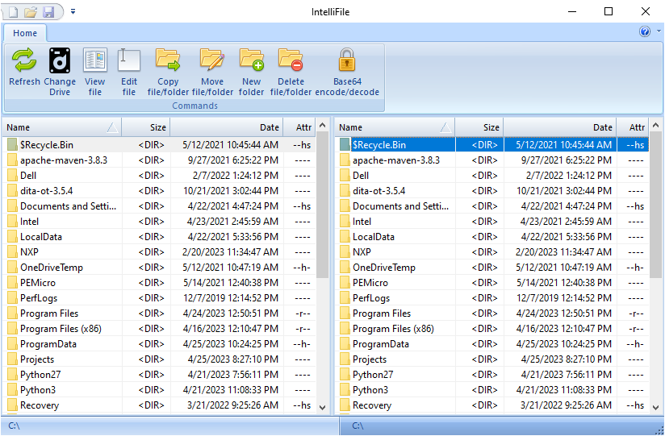

Download:
- [IntelliFileSetup.msi](https://www.moga.doctor/freeware/IntelliFileSetup.msi)
- [IntelliFile.zip](https://www.moga.doctor/freeware/IntelliFile.zip)

## Introduction

_IntelliFile_ is a free (as in “free speech” and also as in “free beer”) file manager. Running in the Microsoft Windows environment, its use is governed by [GNU General Public License v3.0](https://www.gnu.org/licenses/gpl-3.0.html). _IntelliFile_ is written in C++ and uses pure Win32 API and STL which ensures a higher execution speed and smaller program size. By optimizing as many routines as possible without losing user friendliness, _IntelliFile_ is trying to reduce the world carbon dioxide emissions. When using less CPU power, the PC can throttle down and reduce power consumption, resulting in a greener environment. I hope you enjoy _IntelliFile_ as much as I enjoy coding it!

**File handling:**

- Extended copying, moving, renaming and deleting of entire trees.
- ~~Compare files by content, now with built-in text editor.~~
- Encode/Decode files in Base64 format.
- Show/select files with specific search pattern, size, date or contents.
- Enhanced search function with full text search in any files across multiple drives, ~~even inside archives.~~
- ~~Supports Drag & Drop with Explorer/the Desktop.~~

**FTP client:** 

- ~~Built-in FTP client supports most public FTP servers.~~
- ~~Secure FTP over SSL/TLS, enter the URL as follows: ftps://ftp.servername.com~~
- ~~Download in the background (separate thread).~~

**Archive handling:** 

- ~~Archives are handled like subdirectories. You can easily copy files to and from archives.~~
- ~~Built-in ZIP-compatible packer, supports long filenames! This packer is based on ZLIB by Info-Zip.~~
- ~~Pack archives in the background (separate thread).~~

**Some of the above features are still under development!** See the [Roadmap](#roadmap) below for what is planned.

## Getting started

### Install IntelliFile using the installer

- Download the installer
- Run the executable binary and follow the installation flow

The installer will likely require Administrative privileges in order to install _IntelliFile_ (and later, to update _IntelliFile_ or install or update plugins, or anything else that requires writing to the installation directory). If you do not have Administrative privileges, you either need to tell the installer to use a location where you do have write permission (though that may still ask for Administrator privileges), or you may choose not use the installer and instead run a portable edition from a directory where you have write permission.

### Install IntelliFile from zip

These instructions will allow you to run a portable or mini-portable (also called “minimalist”), without requiring administrative privileges.

- Create a new folder somewhere that you have write-permission
- Unzip the content into the new folder
- Run _IntelliFile_ from the new folder

The portable zip edition of _IntelliFile_ can be removed by deleting the directory they came in. If you manually set up file associations or context-menu entries in the OS, it is your responsibility to remove them yourself.

## Application's menu

The _IntelliFile_ menu features the application's most important functions:

- **Refresh**: Refreshes the current view content.
- **Change Drive**: Changes the current view's drive.
- **Reset View**: Resets current folder to root folder.
- **Switch Views**: Switches source view with target view.
- **View File**: Views current selected file.
- **Edit File**: Edits current selected file.
- **Select File**: Shows/selects files with specific search pattern, size, date or contents.
- **Search File(s)**: Enhanced search function with full text search in any files.
- **Copy File/Folder**: Copies current selected file(s)/folder(s).
- **Move File/Folder**: Moves current selected file(s)/folder(s).
- **New Folder**: Creates a new folder.
- **Delete File/Folder**: Deletes current selected file(s)/folder(s).
- **Favorite Folders**: Quick access folder.
- **Base64 Encode/Decode**: Encodes/decodes files using Base64 standard.
- **Command Prompt**: Opens a command prompt.

## Supported Programming Languages

The following programming languages are supported by _IntelliFile_:

- ASP
- Bash
- Batch
- C/C++
- C#
- CMake
- CSS
- Groovy
- HTML
- Java
- JavaScript
- JSON
- Makefile
- Markdown
- MATLAB
- PHP
- Python
- R
- Rust
- SQL
- TCL/TK
- XML

## Roadmap

This roadmap outlines where _IntelliFile_ is heading. It brings together the features marked above as still under development, ideas suggested by users in [Discussions](https://github.com/mihaimoga/IntelliFile/discussions), and the maintenance work that goes into every release. Items are grouped by horizon rather than by date, and their order may change as feedback arrives or as the libraries _IntelliFile_ builds on evolve, so please treat it as a statement of intent, not a promise. For everything that has already shipped, see the [Release Notes](https://github.com/mihaimoga/IntelliFile/releases).

_Last reviewed: November 2026 (version 1.51 in development)._

### Now (in progress and ongoing)

- **Up-to-date components**: each release picks up the latest Scintilla and Lexilla (syntax highlighting), HexCtrl (binary viewer), Microsoft Edge WebView2 (embedded web preview) and genUp4win (automatic updates).
- **Stability, security and performance**: bug fixes, security updates and performance tuning continue alongside new features.
- **Refreshed UI icons**: groundwork has started, with the FatCow “Farm-Fresh Web Icons” set added to the repository as the source of UI icon assets.

### Next (planned, next in line)

- **Drag & Drop**: move and copy files between _IntelliFile_ and Windows Explorer or the Desktop.
- **Compare files by content**: compare two files using the built-in text editor.

### Later (planned, larger efforts)

- **Archive handling**: browse archives like subdirectories and copy files to and from them, with a built-in ZIP-compatible packer that supports long filenames and packs in the background. Full text search will then be able to look inside archives too.
- **FTP client**: a built-in client for public FTP servers, including secure FTP over SSL/TLS (`ftps://` URLs), with downloads running in the background.

Archive handling and the FTP client both involve long-running operations that must not block the user interface, so they are expected to share common background-task infrastructure (worker threads, progress reporting and cancellation).

### Under consideration (ideas, not yet committed)

- **Confirmation before copy and move**: an optional prompt showing the source and destination before `F5` or `F6` starts (suggested in [Discussion #2](https://github.com/mihaimoga/IntelliFile/discussions/2)).
- **Current folder at the top of each pane**: today the current folder is only shown in the window title (suggested in [Discussion #2](https://github.com/mihaimoga/IntelliFile/discussions/2)).
- **Localized user interface**: translated menus, commands and messages (suggested in [Discussion #2](https://github.com/mihaimoga/IntelliFile/discussions/2)).
- **More syntax highlighting languages**: Lexilla already provides lexers for many languages that are not enabled yet, for example YAML, TOML, PowerShell, Ruby, Perl and Lua.
- **Native ARM64 and high-DPI support**: a native ARM64 build for Windows on Arm devices (_IntelliFile_ is currently built for x86 and x64) and Per-Monitor V2 DPI awareness for a sharper interface on high-DPI and mixed-DPI displays.

### Help shape the roadmap

Want to see something sooner, or have an idea that is not listed here? [Open an issue](https://github.com/mihaimoga/IntelliFile/issues) or start a conversation in [Discussions](https://github.com/mihaimoga/IntelliFile/discussions). Contributions are welcome as well: any item above can be picked up through a pull request, as described in the next section.

## Create and Submit your Pull Request

As noted in the [Contributing Rules](https://github.com/mihaimoga/IntelliFile/blob/main/CONTRIBUTING.md) for _IntelliFile_, all Pull Requests need to be attached to a issue on GitHub. So the first step is to create an issue which requests that the functionality be improved (if it was already there) or added (if it was not yet there); in your issue, be sure to explain that you have the functionality definition ready, and will be submitting a Pull Request. The second step is to use the GitHub interface to create the Pull Request from your fork into the main repository. The final step is to wait for and respond to feedback from the developers as needed, until such time as your PR is accepted or rejected.

## Acknowledges

This open source project uses the following libraries:

- René Nyffenegger's [base64](https://github.com/ReneNyffenegger/cpp-base64)
- Armen Hakobyan's [CFolderDialog](https://www.codeproject.com/articles/CFolderDialog-Selecting-Folders)
- Stefan-Mihai MOGA's [genUp4win](https://github.com/mihaimoga/genUp4win)
- Jovibor's [HexCtrl](https://github.com/jovibor/HexCtrl)
- PJ Naughter's [CHLinkCtrl](https://www.naughter.com/hlinkctrl.html)
- PJ Naughter's [CInstanceChecker](https://www.naughter.com/sinstance.html)
- [Lexilla, Scintilla, and SciTE](https://www.scintilla.org/)
- PJ Naughter's [CScintillaCtrl, CScintillaDoc, CScintillaView](https://www.naughter.com/scintilla.html)
- PJ Naughter's [CVersionInfo](https://www.naughter.com/versioninfo.html)
- Mizan Rahman's [CWndResizer](https://www.codeproject.com/articles/MFC-C-Helper-Class-for-Window-Resizing)
